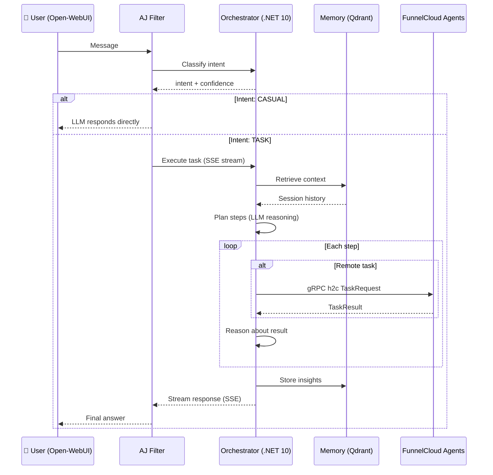
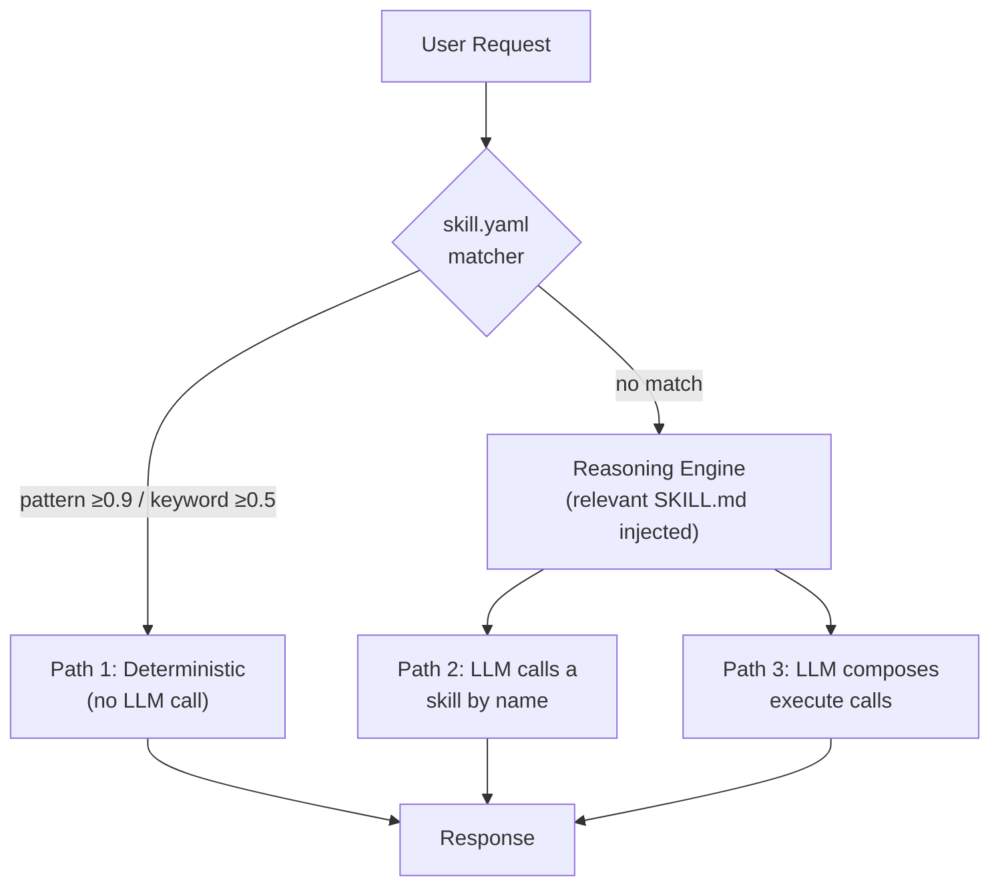
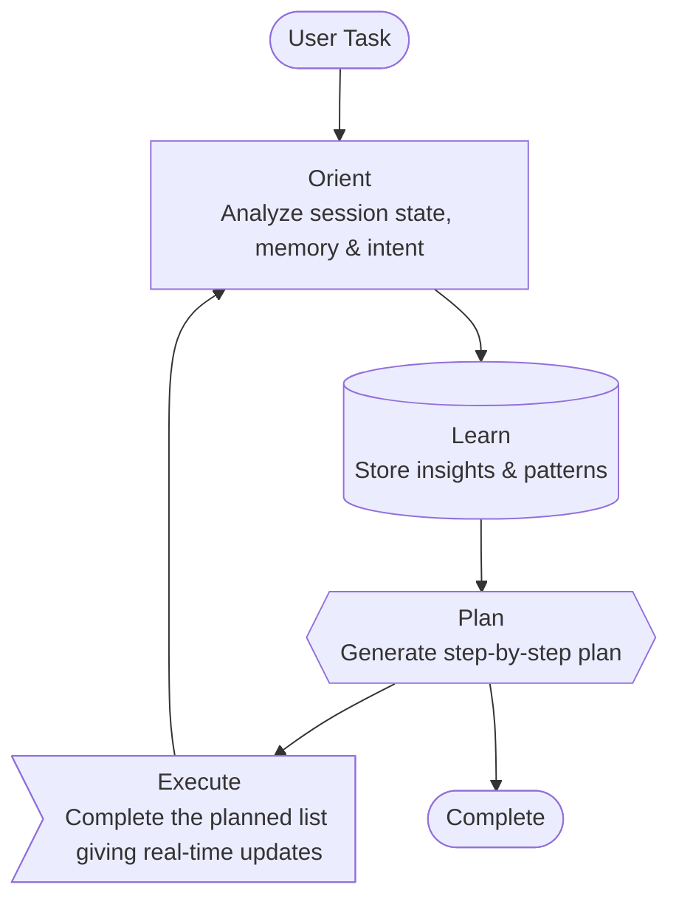
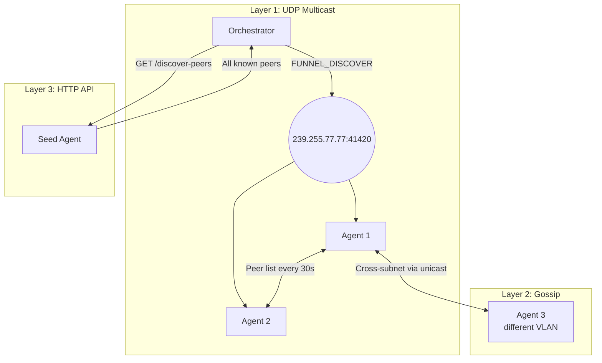
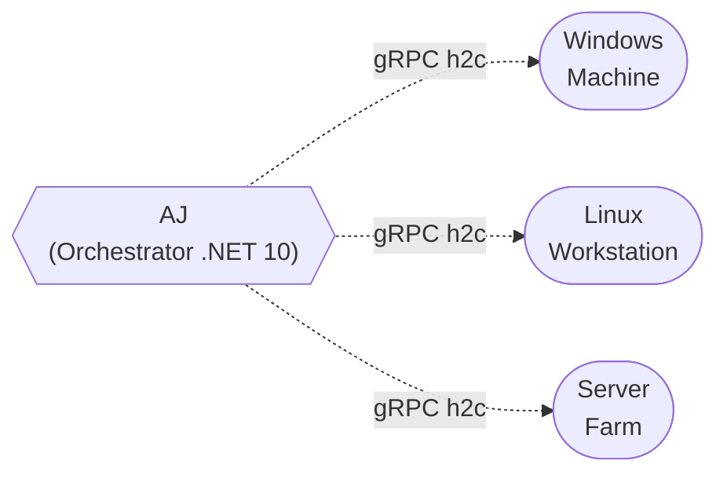
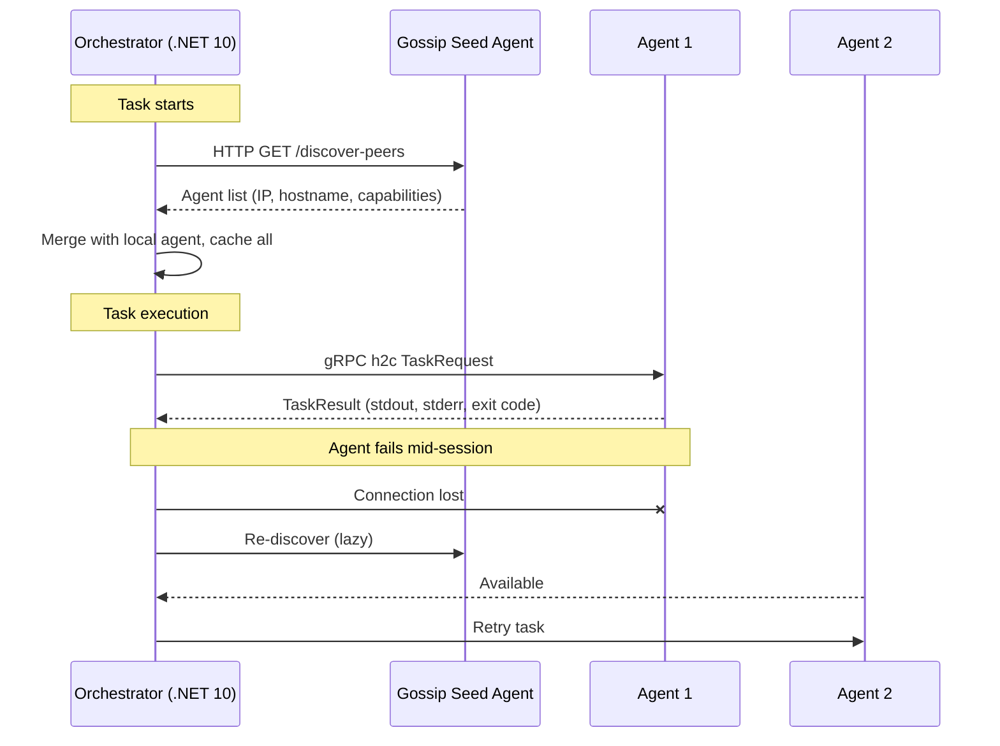

# AJ: Knowledge-Centric AI Infrastructure

**In one sentence:** AJ is a helper that lives on your own computers, listens to what you ask in plain language, works out which machine can do the job, and does it — without anything leaving your network.

## Start Here: One Big Analogy

Imagine a school building with a lot of rooms.

- In every room there's a **helper**. They know how to do things in their room, but they never decide what to do on their own. They wait to be asked. → these are **agents**
- In the front office sits the **planner**. It hears what you need, figures out which room the job belongs to, and sends that room's helper a note. → this is the **orchestrator**
- On a shelf sit **recipe cards**. Each one explains, step by step, how to do a job the school does over and over. → these are **skills**
- And there's a **notebook**. The planner writes down what it learns so nobody has to figure it out again tomorrow. → this is **memory**

That's the whole system: helpers, a planner, recipe cards, and a notebook. Everything below is just those four ideas in more detail. If a section gets dense, come back here.

### Words to Know

Read this table once and the rest of the document gets much easier.

| Word             | What it means here                                                              |
| ---------------- | ------------------------------------------------------------------------------- |
| **LLM**          | The language model — the part that reads your request and decides what to do    |
| **Orchestrator** | The planner. Runs the thinking loop and hands out the work                      |
| **Agent**        | A small program on one machine that runs commands it is given                   |
| **Skill**        | A folder of instructions for one kind of job                                    |
| **Memory**       | A searchable store of things AJ has already learned                             |
| **MCP**          | A standard way to tell _other_ AI apps what AJ can do                           |
| **Context**      | How much text the model can hold in mind at once. It's limited, so we budget it |

### What AJ Cares About

1. **Privacy** — everything stays on hardware you own
2. **Planning** — it thinks before it acts
3. **Showing its work** — you watch each step as it happens
4. **Remembering** — what it learns, it keeps
5. **Adapting** — your corrections change what it does next

---

## Why AJ Exists

Two honest reasons. Neither one is "the world needed another agent framework."

### Reason 1: To learn how all of this actually works

Calling somebody else's AI API teaches you their SDK. Building the whole thing yourself teaches you the platform.

That means getting hands on the unglamorous parts: inference servers, quantization tradeoffs, embeddings and recall, structured outputs, context budgeting, tool-call loops, agent protocols, and fine-tuning. AJ is the excuse to touch every one of those layers instead of letting a library hide them.

There's an honest side effect worth naming: **a learning project gets things wrong sometimes.** This README used to argue that AJ was _better than_ a protocol it now happily speaks. The code settled the argument, and the docs got corrected. That's not an embarrassment — that's the whole point.

### Reason 2: To get real value out of my hardware

A gaming GPU is an expensive thing to leave sitting idle. So are the servers, the domain controllers, and the rest of the rack.

Running the models locally turns a sunk cost into a working one. And as a bonus, nothing about the environment ever leaves it.

There's a nice symmetry here: **the infrastructure AJ manages and the infrastructure AJ runs on are the same infrastructure.**

Everything below follows from those two goals. It's a learning platform that happens to be genuinely useful.

---

## How AJ Gets Work Done

### The Four Things AJ Can Do

The planner has a surprisingly small toolbox. Just four moves:

| Move          | Plain English                    |
| ------------- | -------------------------------- |
| `list_agents` | "Who's here right now?"          |
| `execute`     | "You — run this command."        |
| `think`       | "Hang on, let me plan this out." |
| `complete`    | "Here's your answer."            |

That's it. There is no built-in "read a file" or "run some code" move. **Everything an operator would do goes through `execute`, pointed at one specific machine.**

Two rules make this safe and predictable:

- **Nothing runs locally.** Commands always run out on an agent, never inside the orchestrator's own container.
- **The model writes the commands.** It already knows PowerShell for Windows and Bash for Linux from its training, so it composes the command and the orchestrator delivers it over gRPC.

So the hard part was never "what command should I type?" The hard part is **which machine owns this job, and what order do the steps go in?**

That's exactly what skills are for.

### Skills: Recipe Cards, Not a Menu

Here's a distinction worth slowing down for.

> **A menu** tells you _what you can order._
> **A recipe card** tells you _how the dish is actually made in this kitchen._

Most AI tooling hands the model a menu. AJ hands it recipe cards — which machine owns the job, what the command sequence is, and where the sharp edges are.

A skill is just a folder on disk. It can hold either or both of these files:

| File         | Tier | What it is                                                              |
| ------------ | ---- | ----------------------------------------------------------------------- |
| `skill.yaml` | 1    | A runnable workflow — triggers, parameters, ordered steps, target agent |
| `SKILL.md`   | 2    | Written guidance, handed to the model only when it's relevant           |

**Two useful things happen with those folders at runtime:**

**1. YAML skills become things the model can call by name.** Every `skill.yaml` gets announced in the system prompt _and_ wired into the response schema, so the model can simply say:

```json
{ "tool": "web-fetch", "params": { "url": "https://example.com" } }
```

…and the orchestrator runs that workflow on the skill's target machine. Adding a new capability means **adding a folder, not standing up a new server.**

**2. Markdown skills load only when needed.** The `SKILL.md` text is _not_ all sitting in the model's context. Each skill gets scored against your request (by name, tags, and keywords), and only the ones that clear the bar get loaded.

> **Why this matters:** context is a budget, not a bucket. Fifty skills can sit on disk costing nothing until one of them is actually relevant.

And before either of those paths, there's a shortcut: if your request clearly matches a `skill.yaml` trigger, **the workflow just runs — no model call at all.**

### Where MCP Fits

AJ publishes `list_agents` and `execute_command` over streamable HTTP at `/mcp`. That means VS Code, Claude Desktop, or any other MCP client can drive the agent mesh directly.

So why keep both? **Because they answer different questions.**

|                 | MCP                                      | Skills                                                |
| --------------- | ---------------------------------------- | ----------------------------------------------------- |
| Answers         | "What can I call, and how do I call it?" | "How is this job done, on which host, in what order?" |
| Shape           | Tool schemas over a transport            | Markdown + YAML in a folder                           |
| Lives           | In a server you build and host           | In a directory you edit                               |
| Cost in context | Every tool, every turn                   | Only when relevant                                    |

```
MCP:     Tools advertise → client discovers → model picks from the menu → execute

Skills:  Request scored → matching recipe loaded → matcher or model runs it on the right machine
```

The short version to remember:

> **MCP is how capability is exposed. Skills are how competence is captured.**
> AJ speaks MCP outward, and runs on skills inward.

And either way, one rule holds: **the helpers don't think. They do.** All the reasoning happens in the planner, using session state, memory, and whatever the agents reported about themselves when they checked in.

---

## How AJ Compares to the Big Agent SDKs

By now there's a fairly settled recipe for building agents. OpenAI's Agents SDK, Anthropic's Claude Agent SDK, LangGraph, Google's ADK, Pydantic AI — they argue about details, but they broadly agree on the shape.

So where does AJ line up with that consensus, and where does it wander off? Both lists are worth knowing.

### Where AJ Follows the Pack

| The frontier pattern                                                            | How AJ does it                                                                        |
| ------------------------------------------------------------------------------- | ------------------------------------------------------------------------------------- |
| **The agent loop** — pick a tool, see the result, pick again, until done        | Exactly this, capped at 15 steps for development                                      |
| **Structured tool calls** — constrain the output to a schema, don't parse prose | JSON schema with a separate `anyOf` branch per tool, enforced by the inference server |
| **Skills as folders** — `SKILL.md` plus progressive disclosure                  | Same shape, arrived at independently                                                  |
| **MCP for interop**                                                             | Server at `/mcp`                                                                      |
| **Sessions and memory**                                                         | Session state, plus a vector store for recall                                         |
| **Guardrails** — a check standing between the model and the user                | IRON GATE, catching fabricated command output                                         |

Two of those deserve a closer look.

The **structured output** piece is arguably stricter here than in most SDKs. Instead of one loose `params` object shared by every tool, each built-in tool gets its own schema branch. The grammar physically cannot produce a nested mess where a hostname belongs.

And **skills-as-folders** is a case of convergent evolution. The industry landed on `SKILL.md` with progressive loading. AJ landed in the same place from the opposite direction — starting from "the model keeps forgetting which host runs mail" and working backward.

### Where AJ Deliberately Differs

**1. Execution is a fleet, not a sandbox.**
Most SDKs assume one machine: a container, a sandbox, your laptop. AJ's `execute` always names a target host inside a mesh it discovered at runtime. That makes it a configuration-management plane wearing an agent loop — closer in spirit to Ansible than to a coding assistant.

**2. Capabilities are discovered, not registered.**
Frontier SDKs want a static tool manifest at startup. AJ asks the network who's out there and what they are, on every task. Stand up a new domain controller and it becomes usable without a code change.

**3. The model can be skipped entirely.**
Nearly every SDK routes 100% of requests through the model. AJ consults a pattern matcher first, and a clean match runs the workflow with zero inference. Cheap, instant, and impossible to hallucinate.

**4. Context is curated, not compacted.**
The frontier answer to a filling context window is compaction: summarize the history and carry on. AJ's answer is to avoid filling it — score skills for relevance and load only the winners, truncate long output at a fixed ceiling. Selection rather than summarization.

**5. The model is small, so the scaffolding is loud.**
This is the biggest and least glamorous divergence. Frontier SDKs are written assuming a frontier model that mostly behaves. A 27B model quantized onto a single GPU does _not_ mostly behave — it loops, it retries dead commands, it won't stop when it's done. So the prompt builder injects live nudges as the task runs: loop detection, empty-output warnings, failure counters, a hard stop after three failures.

> That machinery is pure compensation for model size. It is also the single most instructive thing in this codebase about what the big labs are quietly doing on your behalf.

### Where AJ Is Simply Behind

Honesty is half the point of this project, so:

| Missing                  | Why it matters                                                                                                |
| ------------------------ | ------------------------------------------------------------------------------------------------------------- |
| **Human approval gates** | AJ runs shell commands on real infrastructure with no "are you sure?" step. The most serious gap on this list |
| **mTLS to the agents**   | gRPC is h2c today. Remote code execution over unauthenticated transport is a lab-only posture                 |
| **Tracing**              | Logs only. No OpenTelemetry spans, so there's no clean way to see where a slow task actually went             |
| **Evals**                | Unit tests cover the plumbing. Nothing measures whether AJ's _answers_ got better or worse after a change     |
| **Durable execution**    | A restart loses in-flight work. No checkpoint, no resume                                                      |
| **Subagents**            | One loop, one context. No handing a sub-task to a specialist with its own window                              |

The first two are security gaps, and they show up again under [Production Considerations](#security). The rest are the honest price of a one-person learning project.

---

## Architecture Overview

This section zooms in on the machinery. Same four ideas as before — just with the wiring showing.

### Following One Request, Start to Finish

Notice the fork near the top: if you're just chatting, AJ doesn't bother waking anything up. Only real tasks go the long way around.



### The Pieces, and What Each One Does

Seven services. Each has one job.

| Component                | Purpose                                            | Technology                                                                                                     | Port |
| ------------------------ | -------------------------------------------------- | -------------------------------------------------------------------------------------------------------------- | ---- |
| **Filter**               | Intent routing, IRON GATE fabrication detection    | [Open-WebUI](https://github.com/open-webui/open-webui) Python filter                                           | N/A  |
| **Orchestrator API**     | Reasoning + classification + fact extraction + MCP | .NET 10 (C#) + Microsoft.Extensions.AI + [llama.cpp](https://github.com/ggml-org/llama.cpp) structured outputs | 8004 |
| **Memory API**           | Semantic knowledge storage & recall                | [Qdrant](https://github.com/qdrant/qdrant) + Qwen3-Embedding-0.6B (1024-dim, via llama-server)                 | 8000 |
| **Extractor API**        | Media processing (PDF, images, audio)              | Bonsai VLM (via llama-server mmproj) + [faster-whisper](https://github.com/SYSTRAN/faster-whisper)             | 8002 |
| **Qdrant**               | Vector database for semantic search                | [Qdrant](https://github.com/qdrant/qdrant) (in-memory)                                                         | 6333 |
| **llama-server**         | Local LLM inference (host-side, not containerized) | Bonsai-2-27B PTQ1_0 (PrismML llama.cpp fork), 65k ctx + vision                                                 | 8081 |
| **llama-server (embed)** | Embedding inference (host-side)                    | Qwen3-Embedding-0.6B Q8_0                                                                                      | 8082 |

The orchestrator also serves an **MCP endpoint at `/mcp`** (streamable HTTP), exposing `list_agents` and `execute_command` so external MCP clients can drive the agent mesh without going through the reasoning loop. The gRPC internals stay exactly the same underneath.

### Three Ways a Job Gets Done

A request can reach execution by three different routes. AJ always tries the cheapest one first.



| Path                  | Who drives it           | What it costs      | When it happens                                    |
| --------------------- | ----------------------- | ------------------ | -------------------------------------------------- |
| **1. Deterministic**  | `skill.yaml` triggers   | No model call      | Your request matches a known pattern               |
| **2. Skill-as-tool**  | Model picks a skill     | One reasoning loop | The task maps cleanly onto a packaged workflow     |
| **3. Open reasoning** | Model composes commands | Full loop          | Something new — `SKILL.md` guides, doesn't dictate |

**Path 1 never touches the model at all.** It pulls parameters out of your request with regex and runs templated commands. Fast, reliable, boring — in the best way.

**Paths 2 and 3 are the same loop.** The only difference is whether the model names a skill or writes a raw command. Either way, the orchestrator figures out the target machine and sends the work over gRPC.

### IRON GATE: Catching Made-Up Answers

Language models have a bad habit: when they can't run a command, they'll sometimes _write out what the output probably would have looked like_ — confidently, and completely made up.

That's harmless in an essay and dangerous in infrastructure. So the filter watches for it:

```python
# Detects patterns like fabricated ipconfig, ping, dir output
if contains_fabricated_output(response):
    return "[IRON GATE] I detected fabricated output. Let me actually run this command..."
```

If nothing actually ran, you don't get told that it did.

---

## The Loop: Plan → Execute → Learn

Every task walks the same circle.

The important bit is that the arrows **come back around**. AJ doesn't plan once and charge ahead. After each step it looks at what actually happened and decides what to do next.



This is what **agentic reasoning** means in practice: not just doing, but thinking, adjusting, and remembering. You're not querying a lookup table. You're working with something that reasons as it goes.

---

## FunnelCloud: The Helpers in Each Room

Back to the analogy. FunnelCloud agents are the helpers stationed around the building.

Any machine that can run software gets a real agent — one that reports what it can do and executes work securely. For everything else (switches, appliances, cloud services), the orchestrator reaches out over SSH or an API instead.

### Which Door Is Which

An agent listens on three ports, each with its own job:

| Port  | Protocol | Purpose                                     |
| ----- | -------- | ------------------------------------------- |
| 41420 | UDP      | Multicast discovery (group 239.255.77.77)   |
| 41421 | HTTP     | REST API (/health, /peers, /discover-peers) |
| 41235 | gRPC     | Task execution (mTLS planned)               |

### How Agents Find Each Other (Three Tries)

Finding every machine on a real network is harder than it sounds, so AJ uses three methods that cover each other's gaps.



**Why bother with three?** Because each one fails in a different place:

- **Multicast** — fast on a local network, but it can't cross subnets
- **Gossip** — agents pass peer lists to each other, which _does_ cross subnets (unicast TTL=32)
- **HTTP API** — the reliable fallback for when multicast gets swallowed by Docker or WSL networking

### The Best Part: Machines Describe Themselves

Here's the payoff, and it's a big one: **you never have to teach the model your IT stack.**

When agents check in, they say what they are — installed tools, server roles, platform details. So the planner already knows what's possible before it plans anything.

Watch how that changes the conversation:

```
"I need to query Active Directory"
  → Orchestrator sees: domain02 has role:domain-controller
  → Routes AD commands to domain02 automatically

"Restart the web server"
  → Orchestrator sees: webprod01 has role:iis-web-server, webprod02 has role:nginx
  → Asks: "Which web server? IIS on webprod01 or nginx on webprod02?"
```

In the first case it just knew. In the second it knew enough to realize the question was ambiguous — and asked instead of guessing.

Network gear (UniFi, Cisco, and friends) can join the same pattern through MCP servers: expose the device's capabilities as tools, and the orchestrator treats it like any other machine.



**Agent Discovery Sequence:**

The last few lines of this diagram are worth reading closely — that's AJ noticing a helper went missing mid-task and quietly finding another one.



- **Gossip-seed discovery** (HTTP-based, cross-subnet capable)
- **gRPC h2c** (insecure HTTP/2 for task execution — mTLS planned)
- **One-click deployment** to Windows machines
- **Server role detection** (Windows: DC, DNS, DHCP, Exchange, SQL Server, IIS, Hyper-V, File Server; Linux: nginx, Apache, MySQL, PostgreSQL, Docker, Kubernetes)

**Deploy an agent:**

```powershell
# From the target machine (run as Administrator)
.\Deploy-FunnelCloudAgent.ps1 -BuildServer "your-build-server"
```

See [FunnelCloud/README.md](layers/agents/FunnelCloud/README.md) for full setup guide.

---

## Getting Started

### What You'll Need First

- Docker & Docker Compose
- GPU (recommended for LLM inference)
- Python 3.10+
- Open-WebUI instance
- 24GB+ VRAM recommended for 32B models (RTX 3090/4090, A100, H100)

### How Much GPU Memory?

This is the question that stops most people, so here it is up front. "ctx" means context — how much text the model can hold in mind at once. More context costs more memory.

| Model Configuration                 | VRAM Usage | Notes                                 |
| ----------------------------------- | ---------- | ------------------------------------- |
| `ajr1-32b` Q4_K_M, 8k ctx (default) | ~22 GB     | Tight fit on 24GB GPU (RTX 3090/4090) |
| `ajr1-32b` Q4_K_M, 4k ctx           | ~20 GB     | Safe headroom on 24GB GPU             |
| `ajr1-32b` Q8_0                     | ~34 GB     | Requires 48GB+ GPU                    |

Fact extraction currently reuses the same `llama-server` endpoint (no separate small-model instance in Plan A). A dedicated tiny-model server can be added later if recall latency becomes an issue.

### Quick Start

Five steps, in order:

```bash
# 1. Clone and configure
git clone <repo>
cd aj.westerfield.cloud
cp .env.example .env

# 2. Configure Open-WebUI connection
export WEBUI_URL=http://localhost:8180
export WEBUI_API_KEY=$(cat secrets/webui_admin_api_key.txt)

# 3. Start all services
docker compose up -d

# 4. Verify services are running
docker compose ps

# 5. Deploy AJ filter to Open-WebUI
./scripts/deploy-filter.ps1
```

### LLM Inference: llama.cpp + llama-server

AJ runs inference on a **host-side `llama-server`** (from [llama.cpp](https://github.com/ggml-org/llama.cpp)) exposing an OpenAI-compatible API on port `8081`. Containers talk to it via `LLM_BASE_URL` (which falls back to the legacy `OLLAMA_BASE_URL` for older compose overrides).

| Setting       | Value                                            |
| ------------- | ------------------------------------------------ |
| Binary        | `llama-server` (built locally with CUDA)         |
| Endpoint      | `http://localhost:8081/v1/chat/completions`      |
| Model alias   | `ajr1-32b`                                       |
| Default flags | `--flash-attn --n-gpu-layers 99 --ctx-size 8192` |

#### Published Models (HuggingFace)

| Repo                                                                                                                        | Contents                                                                                 | Visibility |
| --------------------------------------------------------------------------------------------------------------------------- | ---------------------------------------------------------------------------------------- | ---------- |
| [`ianwesterfield/AJ-DeepSeekR1Qwen32B-v2.1.0-GGUF`](https://huggingface.co/ianwesterfield/AJ-DeepSeekR1Qwen32B-v2.1.0-GGUF) | Quantized GGUFs (Q4_K_M default, Q8_0) — load these directly with `llama-server`         | Public     |
| [`ianwesterfield/AJ-DeepSeekR1Qwen32B-v2.1.0-lora`](https://huggingface.co/ianwesterfield/AJ-DeepSeekR1Qwen32B-v2.1.0-lora) | LoRA adapter over `deepseek-ai/DeepSeek-R1-Distill-Qwen-32B` — merge + quantize yourself | Private    |

The v3 70B variant (Llama-3.3-70B-Instruct QLoRA) is archived on HuggingFace as adapter-only; it's no longer the primary runtime, but lives on for rent-a-GPU experiments.

#### Build & Launch

```bash
# 1. Build llama.cpp with CUDA (one-time, ~15 min on RTX 4090)
bash scripts/build_llamacpp.sh

# 2. Start the server in a tmux session
bash scripts/start-llama-server.sh

# 3. Attach / detach
wsl -- tmux attach -t llm    # attach
# (Ctrl-B then D to detach)

# 4. Smoke test
curl http://localhost:8081/v1/models
```

For boot-time auto-start, a systemd unit is provided at [`scripts/llama-server.service`](scripts/llama-server.service).

#### Quantization Reference

Quantization is compression for model weights. Fewer bits means a smaller file and less VRAM — but a slightly less sharp model. Q4_K_M is the sweet spot, which is why it's the default.

| Quantization | Bits | Quality        | 32B Model Size |
| ------------ | ---- | -------------- | -------------- |
| Q2_K         | ~2.5 | Poor           | ~12 GB         |
| Q3_K_M       | ~3.5 | Fair           | ~15 GB         |
| **Q4_K_M**   | ~4.5 | Good (default) | ~19 GB         |
| Q5_K_M       | ~5.5 | Very Good      | ~22 GB         |
| Q6_K         | ~6.5 | Excellent      | ~26 GB         |
| Q8_0         | 8    | Near-lossless  | ~34 GB         |

#### Why not Ollama?

AJ started on Ollama (itself a wrapper around llama.cpp) because it was convenient. Going straight to `llama-server` bought four things: the stock OpenAI `/v1/chat/completions` endpoint (so Open-WebUI and every other OpenAI client connects unmodified), first-class `--flash-attn`, faster startup, and one fewer moving part. The docker-compose `ollama` service is left commented out in case rolling back is ever needed.

### Auto-Start on Windows Boot

To automatically start AJ services when Windows boots (using WSL2 + Docker Engine), create a scheduled task:

```powershell
# Run as Administrator
# Note: Replace 'Debian' with your WSL distro name (check with: wsl -l -v)
$Action = New-ScheduledTaskAction -Execute "wsl.exe" -Argument "-d Debian -u root -- bash -c 'service docker start && cd /mnt/c/Code/aj.westerfield.cloud && docker compose up -d'"
$Trigger = New-ScheduledTaskTrigger -AtStartup
$Settings = New-ScheduledTaskSettingsSet -AllowStartIfOnBatteries -DontStopIfGoingOnBatteries -StartWhenAvailable -RunOnlyIfNetworkAvailable
$Principal = New-ScheduledTaskPrincipal -UserId "SYSTEM" -LogonType ServiceAccount -RunLevel Highest
Register-ScheduledTask -TaskName "AJ-Westerfield-Services" -Action $Action -Trigger $Trigger -Settings $Settings -Principal $Principal -Description "Starts AJ services in WSL at system boot"
```

**Verify the task:**

```powershell
Get-ScheduledTask -TaskName "AJ-Westerfield-Services" | Get-ScheduledTaskInfo
```

**Remove the task (if needed):**

```powershell
Unregister-ScheduledTask -TaskName "AJ-Westerfield-Services" -Confirm:$false
```

---

## Development

### The Rules AJ Plays By

Six principles. When a design question comes up, these settle it.

| Principle                        | What it means in practice                                                                               |
| -------------------------------- | ------------------------------------------------------------------------------------------------------- |
| **Knowledge first**              | Whatever the system learns, it keeps and can recall later                                               |
| **Skills over prompts**          | Know-how lives in versioned files on disk, loaded when relevant — not buried in one giant system prompt |
| **Reasoning owns the tools**     | The orchestrator decides what to run. Hardcoded rules don't                                             |
| **Ground truth lives outside**   | Session state is the authority on what happened, not the model's recollection                           |
| **Show output verbatim**         | Tools return raw output and the model passes it through unchanged                                       |
| **Specialists beat generalists** | A small model aimed at one job beats a big model aimed at everything                                    |

### Model Training

AJ includes infrastructure for fine-tuning DeepSeek-R1-Distill-Qwen-32B with LoRA:

- **Hardware**: DigitalOcean H200 GPU Droplet (141GB VRAM, $3.44/hr)
- **Dataset**: Mixed-v1 (~300K examples: 50% conversational, 40% domain knowledge, 10% strategic reasoning)
- **Context Switching**: Model learns `contextType: external/internal` signal for output mode control
- **Method**: Single-GPU LoRA (no distributed training complexity)
- **Output**: Q4_K_M GGUF for RTX 4090 deployment (~18GB)

See [training/README.md](training/README.md) for complete instructions.

### File Structure

```
layers/
├── shared/               # Shared utilities (logging, schemas)
├── orchestrator-dotnet/  # .NET 9 orchestrator (active, production)
│   ├── AJ.Orchestrator.API/        # ASP.NET Core API (controllers, endpoints)
│   ├── AJ.Orchestrator.Domain/     # Domain services
│   │   └── Services/
│   │       ├── ReasoningEngine.cs      # LLM reasoning loop + response parsing
│   │       ├── GrpcAgentClient.cs      # FunnelCloud gRPC task execution
│   │       ├── AgentDiscoveryService.cs # Gossip-seed agent discovery
│   │       ├── SessionStateManager.cs  # Conversation state tracking
│   │       └── TaskPlanner.cs          # Task planning + workspace analysis
│   ├── AJ.Orchestrator.Abstractions/ # Interfaces, models, proto-gen
│   ├── AJ.Orchestrator.Tests/       # 262 unit tests
│   └── AJ.Shared/                   # Shared contracts
├── orchestrator/         # Python orchestrator (DEPRECATED — retained for reference)
├── memory/              # Semantic storage + retrieval
├── pragmatics/          # Intent classification
├── extractor/           # Media processing
└── agents/              # Distributed agent network
    └── FunnelCloud/     # .NET 8 gRPC agent framework
        ├── certs/       # Certificate Authority + agent certs
        ├── FunnelCloud.Agent/   # Agent service (84 unit tests)
        └── FunnelCloud.Shared/  # Shared contracts

filters/
└── aj.filter.py         # Open-WebUI entry point

training/
├── scripts/             # Training pipeline
├── configs/             # QLoRA configs (4090 optimized)
└── data/                # Training datasets
```

### Extending AJ

**The orchestrator is .NET 9 (C#)**. The Python orchestrator is deprecated.

The "FunnelCloud Remote Execute" philosophy means most operations are commands run on agents.
The LLM generates appropriate commands (PowerShell/Bash) from its training.

**Available tools** (defined in `ReasoningEngine.cs`):

| Tool          | Purpose                            | Parameters            |
| ------------- | ---------------------------------- | --------------------- |
| `list_agents` | Discover online FunnelCloud agents | None                  |
| `execute`     | Run a command on any agent         | `agent_id`, `command` |
| `think`       | Planning/reasoning step            | `thought`             |
| `complete`    | Final response to user             | `answer`              |

**Key files:**

| File                                                                                   | Purpose                                             |
| -------------------------------------------------------------------------------------- | --------------------------------------------------- |
| `layers/orchestrator-dotnet/AJ.Orchestrator.Domain/Services/ReasoningEngine.cs`        | LLM reasoning loop, system prompt, response parsing |
| `layers/orchestrator-dotnet/AJ.Orchestrator.Domain/Services/GrpcAgentClient.cs`        | gRPC task execution on FunnelCloud agents           |
| `layers/orchestrator-dotnet/AJ.Orchestrator.Domain/Services/AgentDiscoveryService.cs`  | Gossip-seed agent discovery                         |
| `layers/orchestrator-dotnet/AJ.Orchestrator.API/Controllers/OrchestratorController.cs` | API endpoints (classify, run-task SSE)              |

**Retrain intent classifier:**

```powershell
cd layers/pragmatics/static
python train_intent_classifier.py    # Takes 2-5 minutes
docker compose up -d --build pragmatics_api
```

---

## Production Considerations

### Security

- **gRPC Communication**: Currently h2c (insecure HTTP/2); mTLS planned for production
- **Workspace Isolation**: Each user has isolated memory and state
- **Permission Gating**: Tools validate permissions before execution
- **No External Calls**: Everything stays on your infrastructure

### Performance

- **Intent Classification**: <100ms (DistilBERT)
- **Memory Search**: <500ms (Qdrant + embeddings)
- **Tool Execution**: Depends on task (local files = fast, remote tasks = network dependent)
- **Streaming Results**: SSE from orchestrator to filter to user (no wait)

### Scalability

- **Horizontal**: Add more FunnelCloud agents as needed
- **Vertical**: Upgrade orchestrator with larger LLM model
- **Multi-User**: Qdrant can scale to millions of vectors

---

## Roadmap

### Phase 1: Foundation ✅

- [x] Logging infrastructure
- [x] Intent classification (DistilBERT 4-class)
- [x] Tool dispatcher (unified routing)
- [x] Semantic memory (Qdrant vectors)
- [x] Orchestrator reasoning engine
- [x] Multi-step task planning
- [x] Session state tracking (ground truth)
- [x] Target selection safety (multi-agent disambiguation)
- [x] Agent-aware intent classification (60+ agent task examples)

### Phase 2: FunnelCloud Agents ✅

- [x] Agent discovery protocol (HTTP gossip-seed)
- [x] Cross-subnet gossip-seed bootstrap
- [x] Certificate infrastructure (CA + agent certs — not yet enforced)
- [x] gRPC service definition (task_service.proto)
- [x] Windows service installation (NSSM)
- [x] One-click deployment scripts
- [x] Server role detection (Exchange, DC, DNS, DHCP, IIS, SQL Server, etc.)
- [x] Self-contained deployment (no .NET runtime dependency)
- [x] Cross-subnet gossip-seed discovery
- [x] gRPC h2c remote command execution
- [ ] mTLS security (currently h2c insecure)
- [ ] Multi-agent orchestration (parallel execution)

See [FunnelCloud/README.md](layers/agents/FunnelCloud/README.md) for detailed deployment instructions.

### Phase 3: .NET Orchestrator Migration ✅

**Completed**: Full rewrite of orchestrator from Python/FastAPI to .NET 9 (C#).

- [x] ReasoningEngine with 4-tool architecture (list_agents, execute, think, complete)
- [x] R1-Distill `<think>` block stripping and code fence handling
- [x] Tool name normalization (hallucination recovery)
- [x] Parameter alias normalization (agent_id, target_agent_name, etc.)
- [x] Gossip-seed cross-subnet agent discovery
- [x] gRPC h2c remote command execution
- [x] SSE streaming events (status, step, result, complete, error)
- [x] Session state management
- [x] 346 unit tests (262 orchestrator + 84 FunnelCloud)

### Phase 4: Model Fine-Tuning 🔄 (In Progress)

**Current models:**
| Model | Base | Purpose |
|-------|------|----------|
| `r1-distill-aj:32b` | DeepSeek-R1-Distill-Qwen-32B | Reasoning with `<think>` tags |
| `qwen2.5-aj:32b` | Qwen2.5-32B-Instruct | Direct answers |

**Progress:**

- [x] Training data generation (43 generators, 5,205 examples)
- [x] [QLoRA](https://github.com/artidoro/qlora) training pipeline ([PEFT](https://github.com/huggingface/peft)/[TRL](https://github.com/huggingface/trl))
- [x] Training capture system (live data collection)
- [x] Agentic training infrastructure (trajectory format)
- [x] Model export to GGUF + publish to [HuggingFace](https://huggingface.co/ianwesterfield)
- [ ] A/B testing framework
- [ ] Distillation pipeline (72B → 7B/14B for deployment)

See [training/README.md](training/README.md) for details.

### Phase 5: Knowledge Graph 📅

- [ ] Entity extraction from conversations
- [ ] Relationship mapping
- [ ] Temporal reasoning (time-aware recall)
- [ ] Pattern detection (workflow learning)

### Phase 6: Advanced Features 📅

- [ ] **MCP-native tool APIs** (migrate from REST to Model Context Protocol)
- [ ] Adaptive tool selection (learning from outcomes)
- [ ] Error recovery strategies
- [ ] Performance optimization
- [ ] Multi-user isolation

---

## Troubleshooting

### Services won't start?

```powershell
# Check docker compose logs
docker compose logs -f orchestrator_api

# Verify network connectivity
docker network ls
docker network inspect webtools_network

# Rebuild images
docker compose up -d --build
```

### Ollama model not loading or keeps unloading?

```powershell
# Check container health status
wsl docker ps --filter "name=ollama" --format "table {{.Names}}\t{{.Status}}"

# Verify model is loaded
wsl docker exec ollama ollama ps
# Should show: r1-distill-aj:32b-8k ... Forever

# Check VRAM usage
wsl nvidia-smi --query-gpu=memory.used,memory.total --format=csv

# Manually load model with keep-alive
wsl docker exec ollama sh -c "echo 'ping' | ollama run r1-distill-aj:32b-8k"

# Check healthcheck logs
wsl docker inspect ollama --format "{{range .State.Health.Log}}ExitCode:{{.ExitCode}} Output:{{.Output}}---{{end}}"
```

**Common issues:**

- **"curl: not found"** in healthcheck: The `ollama/ollama:latest` image doesn't include curl. Use `ollama list` or `ollama run` instead.
- **Model unloads after prompt**: Ensure `OLLAMA_KEEP_ALIVE=-1` is set in docker-compose.yaml.
- **9%/91% CPU/GPU split**: Model partially offloaded to CPU due to VRAM pressure. Consider using 4k context variant.

### Intent classifier not working?

```powershell
# Check pragmatics service
Invoke-RestMethod http://localhost:8001/health

# Test classification
$body = @{ text = "save this to memory" } | ConvertTo-Json
Invoke-RestMethod -Uri http://localhost:8001/api/pragmatics/classify `
    -Method Post -ContentType application/json -Body $body
```

### Memory not persisting?

```powershell
# Check Qdrant service
Invoke-RestMethod http://localhost:6333/health

# View collections
Invoke-RestMethod http://localhost:6333/collections
```

### FunnelCloud agent not discovered?

```powershell
# Check agent service is running
Get-Service FunnelCloudAgent

# View agent logs
Get-Content "C:\FunnelCloud\Agent\logs\stdout.log" -Tail 50

# Test gossip-seed discovery (from orchestrator container)
wsl docker exec orchestrator_api curl -s http://GOSSIP_SEED_IP:41421/api/discovery/agents

# Test agent HTTP endpoint directly
Invoke-RestMethod http://AGENT_IP:41421/api/discovery/agents

# Check firewall allows HTTP 41421 and gRPC 41235
netsh advfirewall firewall show rule name=all | findstr "41421 41235"
```

### FunnelCloud deployment fails?

```powershell
# Test PowerShell Remoting to build server
Test-WSMan -ComputerName BUILD_SERVER_NAME

# Check TrustedHosts configuration
Get-Item WSMan:\localhost\Client\TrustedHosts

# Verify certificates exist on build server
Test-Path "C:\Code\aj.westerfield.cloud\layers\agents\FunnelCloud\certs\ca\ca.crt"
```

See [FunnelCloud/README.md](layers/agents/FunnelCloud/README.md) for detailed troubleshooting.

---

## Contributing

This is a private research project. For research partnerships or questions, contact the team.

---

## License

UNLICENSED
